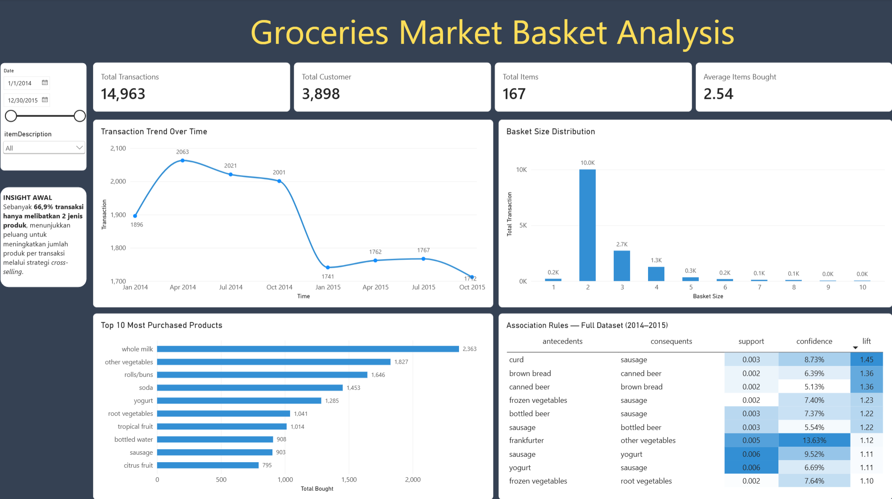

# Market Basket Analysis — Groceries Purchase Behavior

**Analisis pola belanja pelanggan untuk mengidentifikasi kombinasi produk yang berpotensi mendukung strategi cross-selling dan bundling.**

**Tools:** Python · Pandas · Matplotlib · Seaborn · MLxtend (Apriori & Association Rules) · Jupyter Notebook · Power BI

## Project Overview

Project ini menganalisis transaksi pembelian pada **Groceries Dataset** untuk memahami perilaku belanja pelanggan, mengidentifikasi produk yang paling sering dibeli, dan menemukan asosiasi antarproduk dalam satu keranjang belanja (*market basket*).

Analisis dilakukan menggunakan **Python dan Jupyter Notebook** untuk data preparation, exploratory data analysis (EDA), serta penerapan **Apriori Algorithm** dan **Association Rules**. Hasilnya divisualisasikan melalui **Power BI** dan diterjemahkan menjadi rekomendasi bisnis yang dapat diuji.

Fokus utama project bukan memprediksi penjualan, melainkan menemukan **peluang penawaran produk pelengkap berdasarkan pola pembelian aktual**.

---

## Business Questions

1. Bagaimana tren jumlah transaksi pelanggan selama periode pengamatan?
2. Berapa banyak jenis produk yang umumnya dibeli dalam satu transaksi?
3. Produk apa saja yang paling sering dibeli pelanggan?
4. Kombinasi produk apa yang memiliki asosiasi pembelian positif?
5. Bagaimana hasil analisis dapat diterapkan pada strategi **cross-selling**, **product placement**, dan **bundling**?

---

## Data Source

Dataset diperoleh dari Kaggle: [**Groceries Dataset — heeraldedhia**](https://www.kaggle.com/datasets/heeraldedhia/groceries-dataset).

| Informasi | Nilai |
|---|---:|
| Data awal | 38.765 baris |
| Jumlah kolom awal | 3 |
| Periode data | 2014–2015 |
| Total transaksi pada dashboard | 14.963 |
| Total pelanggan unik | 3.898 |
| Jenis produk unik | 167 |
| Rata-rata jenis produk per transaksi | 2,54 |

**Kolom pada dataset:**

| Kolom | Deskripsi |
|---|---|
| `Member_number` | Identitas pelanggan |
| `Date` | Tanggal pembelian |
| `itemDescription` | Nama produk yang dibeli |

Dataset tidak menyediakan harga, nilai transaksi, biaya, ataupun margin keuntungan. Karena itu, hasil analisis digunakan untuk memahami **pola dan asosiasi pembelian**, bukan untuk menghitung kenaikan pendapatan atau laba secara langsung.

---

## Data Preparation & Quality Checking

Sebelum melakukan analisis, data diperiksa dan dibersihkan agar transaksi dan kombinasi produk dapat diidentifikasi dengan lebih konsisten.

| Pemeriksaan | Temuan | Penanganan |
|---|---|---|
| Missing values | Tidak ditemukan | Tidak memerlukan imputasi |
| Tipe data tanggal | `Date` awalnya bertipe string | Konversi ke `datetime` |
| Duplikasi | 759 baris (1,95%) | Menghapus baris duplikat |
| Konsistensi nama produk | 436 baris (1,12%) mengandung spasi awal/akhir | Membersihkan dengan `str.strip()` |
| Outlier `Member_number` | Tidak ditemukan berdasarkan boxplot pada analisis | Tidak dilakukan penghapusan |
| Transaction identifier | Tidak tersedia pada data asli | Membuat `Transaction_ID` |

### Feature Engineering

Kolom `Transaction_ID` dibuat dengan menggabungkan identitas pelanggan dan tanggal pembelian:

```python
df['Transaction_ID'] = (
    df['Member_number'].astype(str)
    + '_'
    + df['Date'].dt.strftime('%d-%m-%Y')
)
```

Dengan pendekatan ini, produk yang dibeli oleh pelanggan **pada tanggal yang sama** diasumsikan berada dalam satu transaksi. Ini merupakan keterbatasan data: jika satu pelanggan berbelanja lebih dari sekali pada hari yang sama, beberapa transaksi dapat tergabung.

---

## Analysis Method

### 1. Exploratory Data Analysis (EDA)

EDA dilakukan untuk memeriksa:

- Tren jumlah transaksi dari waktu ke waktu.
- Distribusi jumlah jenis produk per transaksi (*basket size*).
- Sepuluh produk yang paling sering dibeli.
- Perubahan rata-rata jumlah jenis produk dalam keranjang belanja.

### 2. Apriori Algorithm

Algoritma **Apriori** digunakan untuk mencari *frequent itemsets* atau kelompok produk yang sering muncul bersama.

| Parameter | Nilai |
|---|---:|
| Minimum support | 0,002 (0,2%) |
| Frequent itemsets yang dihasilkan | 330 |

### 3. Association Rules

Dari *frequent itemsets*, dibuat aturan asosiasi dengan **minimum confidence 5%**, kemudian hasilnya dievaluasi menggunakan:

- **Support:** proporsi transaksi yang mengandung kombinasi produk tertentu.
- **Confidence:** proporsi transaksi yang mengandung produk A dan juga mengandung produk B.
- **Lift:** ukuran kekuatan asosiasi relatif terhadap frekuensi normal pembelian produk B; **lift > 1** menunjukkan asosiasi positif.

Hubungan ini menunjukkan **asosiasi**, bukan bukti bahwa pembelian satu produk menyebabkan pembelian produk lainnya.

---

## Dashboard Preview



Dashboard Power BI menampilkan KPI transaksi, jumlah pelanggan, jumlah jenis produk, rata-rata *basket size*, tren transaksi, produk terlaris, distribusi ukuran keranjang, dan tabel **Association Rules**.

File dashboard: [**Market Basket Analysis.pbix**](Dashboard/Market%20Basket%20Analysis.pbix)

---

## Key Findings

### 1. Jumlah transaksi mengalami penurunan

Jumlah transaksi pada 2015 tercatat **sekitar 12,5% lebih rendah dibandingkan 2014**. Temuan ini menjadi sinyal perlunya mengevaluasi aktivitas pembelian dan menguji strategi yang dapat meningkatkan frekuensi maupun isi keranjang belanja.

> Catatan: metrik ini menggambarkan **jumlah transaksi**, bukan nilai penjualan atau pendapatan, karena dataset tidak memiliki informasi harga.

### 2. Sebagian besar pelanggan membeli dua jenis produk

Dari **14.963 transaksi**, sebanyak **10.012 transaksi (66,91%)** hanya terdiri dari **dua jenis produk**. Rata-rata keseluruhan adalah **2,54 jenis produk per transaksi**.

Distribusi ini mengindikasikan ruang untuk menguji rekomendasi produk pelengkap agar pelanggan mempertimbangkan pembelian tambahan.

### 3. Produk kebutuhan sehari-hari mendominasi pembelian

| Produk | Jumlah transaksi yang mengandung produk |
|---|---:|
| Whole milk | 2.363 |
| Other vegetables | 1.827 |
| Rolls/buns | 1.646 |

**Whole milk** merupakan produk paling sering dibeli, muncul pada sekitar **15,8% transaksi**. Produk-produk dengan frekuensi pembelian tinggi dapat dijadikan prioritas dalam perencanaan ketersediaan stok.

### 4. Curd dan sausage memiliki asosiasi positif

Beberapa aturan asosiasi yang ditemukan:

| Antecedent (Jika membeli...) | Consequent (...juga membeli) | Confidence | Lift |
|---|---|---:|---:|
| Curd | Sausage | 8,73% | **1,45** |
| Frozen vegetables | Sausage | 7,40% | 1,23 |
| Bottled beer | Sausage | 7,37% | 1,22 |
| Sausage | Yogurt | 9,52% | 1,11 |

Aturan **curd → sausage** memiliki lift tertinggi di antara contoh asosiasi dengan *sausage* yang dibahas, yaitu **1,45**. Artinya, pelanggan yang membeli *curd* memiliki kecenderungan membeli *sausage* sekitar **1,45 kali** tingkat pembelian *sausage* pada keseluruhan transaksi.

Meskipun demikian, confidence-nya baru **8,73%**. Karena itu, pasangan produk ini lebih tepat dipandang sebagai **hipotesis promosi yang perlu diuji**, bukan jaminan bahwa bundling akan berhasil.

---

## Business Recommendations

### 1. Menguji bundling `Curd + Sausage`

Menawarkan paket *curd* dan *sausage* kepada segmen pelanggan yang relevan, lalu membandingkan performa paket terhadap penjualan tanpa bundling.

### 2. Menerapkan cross-selling yang lebih terarah

Menguji rekomendasi *sausage* saat pelanggan membeli *curd* atau *frozen vegetables* melalui kasir, aplikasi belanja, atau materi promosi dalam toko.

### 3. Mengevaluasi penempatan produk

Menguji penempatan produk yang memiliki asosiasi positif pada lokasi berdekatan untuk meningkatkan kemudahan pelanggan menemukan produk pelengkap.

### 4. Menjaga ketersediaan produk dengan frekuensi tinggi

Memprioritaskan pemantauan stok **whole milk**, **other vegetables**, dan **rolls/buns** karena sering muncul pada transaksi pelanggan.

### 5. Mengukur dampak melalui eksperimen

Lakukan pengujian terbatas atau **A/B test**. Metrik yang dapat dipantau setelah data penjualan tambahan tersedia mencakup *attachment rate*, *conversion rate*, nilai keranjang, margin, dan keuntungan tambahan. Kenaikan transaksi maupun profit **belum dapat dibuktikan dari dataset ini saja**.

---

## Conclusion

Market Basket Analysis terhadap **14.963 transaksi** menunjukkan bahwa mayoritas keranjang belanja berisi dua jenis produk dan beberapa produk memiliki asosiasi positif untuk dipertimbangkan dalam strategi cross-selling.

**Whole milk**, **other vegetables**, dan **rolls/buns** menjadi produk yang paling sering dibeli. Sementara itu, hubungan **curd → sausage** (confidence **8,73%**, lift **1,45**) memberikan salah satu peluang pengujian bundling yang paling relevan berdasarkan hasil association rules.

Dengan demikian, hasil analisis dapat menjadi dasar untuk **menyusun hipotesis promosi berbasis data**, yang efektivitas komersialnya tetap perlu diverifikasi melalui eksperimen dan data nilai transaksi.

---

## Tools & Technologies

- **Python** — data cleaning, feature engineering, EDA, dan market basket analysis.
- **Pandas** — pengolahan dan transformasi data.
- **Matplotlib & Seaborn** — visualisasi eksploratif.
- **MLxtend** — Apriori Algorithm dan Association Rules.
- **Jupyter Notebook** — dokumentasi proses analisis.
- **Power BI** — dashboard interaktif dan visualisasi hasil.
- **Microsoft PowerPoint / PDF** — presentasi hasil dan data storytelling.

---
